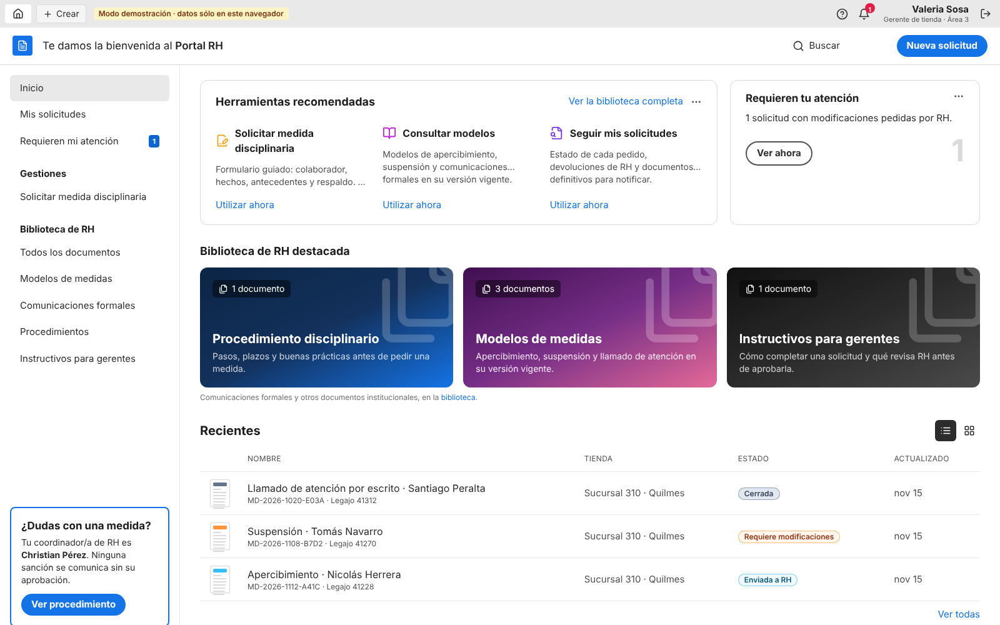

# Box de Herramientas RH · Farmatodo

Portal de Recursos Humanos para gerentes de tienda y el equipo de RH. Además de
consultar documentación, permite **pedir medidas disciplinarias con un formulario
guiado**, **generar el borrador automáticamente con el modelo oficial de RH** y
hacerlo pasar por un **circuito de aprobación obligatorio** con historial de
auditoría completo.

> Ninguna sanción puede emitirse ni comunicarse desde el portal sin la
> aprobación de un usuario autorizado de RH. Antes de eso, el documento es
> siempre un **BORRADOR** sin validez.



Tecnología: React 18 + TypeScript + Vite + Tailwind CSS · Word con docxtemplater ·
Supabase (PostgreSQL + autenticación + RLS) para uso real.

---

## Puesta en marcha

```bash
npm install
npm run dev        # http://localhost:5173
npm test           # pruebas del circuito, permisos y modelos
npm run build      # genera dist/ (sitio estático)
```

### Dos modos de funcionamiento

| Modo | Cuándo | Dónde quedan los datos |
|---|---|---|
| **Demostración** (por defecto) | Sin variables de Supabase | En el navegador (IndexedDB). No se comparten entre equipos. La barra superior lo avisa. |
| **Supabase** | Con `VITE_SUPABASE_URL` y `VITE_SUPABASE_ANON_KEY` | Base PostgreSQL compartida; los permisos los aplica la base. |

> ⚠️ **Para usarlo con datos reales hay que configurar Supabase.** En modo
> demostración las reglas se aplican en el navegador y sirven para probar el
> circuito, pero no son una barrera de seguridad.

**Usuarios de demostración** (contraseña `demo1234`; la pantalla de ingreso tiene accesos directos):

| Usuario | Rol | Alcance |
|---|---|---|
| `admin.rh@demo.portal` | Administrador/a de RH | Todo; administra modelos, tipos, circuito y usuarios |
| `coord.area1@demo.portal` … `coord.area3@demo.portal` | Coordinador/a de RH | Su área |
| `gerente.area1@demo.portal` … `gerente.area3@demo.portal` | Gerente de área | Autoriza vacantes de su área |
| `gerente.101@demo.portal`, `gerente.205@demo.portal`, `gerente.310@demo.portal` | Gerente de tienda | Sus tiendas |

Personas, legajos y tiendas son ficticios. Los textos de los modelos de ejemplo
**deben reemplazarse** por los modelos vigentes de la empresa revisados por Legales.

### Configurar Supabase

1. Crear el proyecto y ejecutar completo [`supabase/schema.sql`](supabase/schema.sql) en **SQL Editor**.
2. Crear el primer usuario en **Authentication → Users**, copiar su UID y registrarlo como administrador
   (el ejemplo está al final de `schema.sql`).
3. Cargar **tiendas** (`stores`) y **colaboradores** (`employees`) con *Table Editor → Import CSV*.
4. Copiar `.env.example` a `.env`, completar las dos variables y `npm run build`. Publicar `dist/`.
5. Desde el portal, el administrador carga modelos, tipos de medida, situaciones, el ruteo por área y los
   perfiles del resto de los usuarios (antes, crear cada usuario en Authentication y usar su UID).

---

## Qué incluye

### 1. Biblioteca de RH
Modelos de apercibimiento, suspensión, llamado de atención, comunicaciones formales,
procedimientos e instructivos. Siempre se muestra la **versión vigente** con su fecha
de actualización. Se pueden ver, imprimir, descargar (Word/PDF original si se cargó) y,
si el modelo corresponde a una medida, usarlo directamente para iniciar una solicitud.

### 2. Solicitud de medida disciplinaria (gerentes)
Formulario guiado en 5 pasos: **colaborador** (por nombre o legajo; puesto, tienda y área
se completan solos) → **el hecho** (fecha, tipo de situación, descripción detallada de al
menos 80 caracteres) → **antecedentes y respaldo** (con aviso de medidas previas del
colaborador y carga de archivos) → **medida y modelo** (con los campos adicionales que
pida el modelo, p. ej. días y fechas de una suspensión) → **revisión y envío**.
No se puede enviar mientras falte algo; cada paso indica qué falta.

### 3. Generación automática del borrador
El modelo usa marcadores `{{colaborador}}`, `{{legajo}}`, `{{fecha_incidente}}`,
`{{descripcion_hechos}}`, etc. El sistema los completa con los datos de la solicitud.
Si RH cargó el modelo en **Word (.docx)** con esos marcadores, se completa el Word
**respetando formato, logos y tipografía**. El borrador lleva la leyenda
*"BORRADOR – SIN VALIDEZ HASTA SU APROBACIÓN POR RRHH"* y marca de agua.

### 4. Circuito de aprobación
1. El gerente envía → se crea la **versión 1** inmutable de la solicitud.
2. El sistema asigna al **coordinador del área** (según el ruteo configurado) y le envía un aviso.
3. El coordinador toma el caso, revisa datos, antecedentes y adjuntos, y deja **observaciones internas**.
4. Decide: **aprobar**, **rechazar** o **solicitar modificaciones** (estas dos con devolución obligatoria).
5. Si pide modificaciones, el gerente ve la devolución, corrige y reenvía → **versión 2**, y así sucesivamente.
6. Al aprobar se genera el **documento definitivo** (sin leyenda de borrador, con el nombre del
   aprobador), con su **huella SHA-256**, y se registra quién aprobó, cuándo y qué versión.
7. El gerente registra la **notificación al colaborador**; RH **cierra** el caso.

### 5. Backoffice "Solicitudes pendientes de aprobación"
Número, colaborador, legajo, tienda, área, medida, fecha de presentación (con días
hábiles transcurridos y alerta de fuera de plazo), gerente solicitante y estado.

### 6. Seguimiento
Estados: Borrador · Enviada a RH · Pendiente de revisión · Requiere modificaciones ·
Aprobada · Rechazada · Cerrada. Pestañas de **Versiones** (con qué cambió entre
una y otra) e **Historial** (línea de tiempo de auditoría) en cada solicitud.

### 7. Administración de modelos (sólo administradores de RH)
Cargar modelos nuevos, editar texto con marcadores, **definir los campos que debe
completar el gerente** (texto, fecha, número, lista; obligatorio u opcional), asociar
cada modelo a tipos de solicitud, subir/reemplazar el Word, activar/desactivar, ver
el **historial de versiones** y restaurar una anterior. Cada cambio de contenido publica
una versión nueva; las solicitudes ya enviadas conservan la versión con la que se generaron.
También: tipos de medida (con requisitos de antecedentes/respaldo), tipos de situación,
política de aprobación, ruteo por área y usuarios.

### Licencias y vacaciones
- **Licencias:** el gerente avisa (tipo, fechas, cuándo avisó el colaborador) y RH se entera en el momento.
  El certificado se carga entonces o después; el portal marca los **certificados demorados** (plazo configurable).
  No se pide diagnóstico. RH **da por recibida** u **observa** (p. ej. certificado sin sello) y el gerente corrige.
- **Vacaciones:** el gerente carga período y fechas; el portal genera la **notificación de vacaciones** con el
  modelo de RH (Word o impresión) para que firme el colaborador. Al subir la copia firmada llega a RH.
  Advierte si no empieza un lunes (art. 151), si se notifica con menos de 45 días (art. 154), si excede los días
  por antigüedad (art. 150) o si ingresó en el segundo semestre (art. 153). Si cambian las fechas, la firma
  anterior deja de valer y hay que volver a firmar.

### Cartelera de comunicados
Los coordinadores y RH publican comunicados (informativo, importante, urgente) para todas las áreas o algunas,
con adjuntos, vencimiento y fijado arriba. Aparecen al tope del inicio de los gerentes, les llega un aviso y
marcan "leído"; RH ve quién lo leyó y quién no.

### Vacantes y headcount
- **Headcount:** RH (cada coordinador en sus áreas) define cuántos puestos autorizados tiene cada tienda.
  Disponibles = autorizados − ocupados − vacantes en curso. Un reemplazo de alguien que se va libera su lugar.
- **El gerente sólo puede pedir** puestos con lugar disponible. La vacante va al **gerente de área** (rol nuevo),
  que autoriza o rechaza; después RH la toma y la avanza por etapas: búsqueda → entrevistas → preocupacional →
  ingreso → cubierta, cargando **novedades** en cada paso.
- Gerente, gerente de área y RH ven el **line up**: en qué etapa está, cuándo entró a cada una y cuántos días lleva.
- Al cubrirla, el ingresante se da de alta en el plantel de la tienda (y se da de baja a quien reemplaza).

### 8. Seguridad y control
| Regla | Dónde se aplica |
|---|---|
| Sólo roles aprobadores de RH deciden (configurable; nunca gerentes) | `workflow.ts` + trigger `requests_guard` |
| Nadie decide sobre una solicitud que inició | ídem + `final_docs_guard` |
| El coordinador sólo decide sobre sus áreas (configurable) | ídem |
| Datos bloqueados después de enviar; tras la aprobación no se modifican | trigger `requests_guard` |
| Cambio posterior = **rectificación**: la aprobación queda sin efecto y requiere una nueva | `rectify()` + trigger |
| Versiones, documentos definitivos, auditoría y archivos: sólo agregado | trigger `append_only` + RLS |
| Huella SHA-256 verificada por la base al guardar el definitivo | `final_docs_guard` |
| El gerente no ve las observaciones internas de RH | RLS `audit_read` |
| Cada cambio de estado queda registrado también por la base | trigger `requests_status_log` |

Historial de auditoría global con filtros y exportación CSV.

---

## Estructura

```
src/lib/types.ts          Modelo de datos (coincide con supabase/schema.sql)
src/lib/workflow.ts       Reglas del circuito: permisos, transiciones, validación, ruteo
src/lib/template.ts       Marcadores {{campo}}, texto y Word
src/lib/service.ts        Operaciones (enviar, tomar, decidir, rectificar, modelos…) + auditoría
src/lib/backend/          Demostración (IndexedDB) y Supabase
src/lib/seed.ts           Datos y modelos de ejemplo
src/pages/                Pantallas
supabase/schema.sql       Tablas, RLS y triggers
supabase/pruebas-permisos.sql  Pruebas de las reglas en una base descartable
docs/modulo-rh.md         Guía de uso y de administración
```

## Pruebas

- `npm test`: reglas del circuito, motor de modelos (incluido Word) y un recorrido completo
  gerente → coordinador → aprobación → intento de modificación → rectificación.
- `supabase/pruebas-permisos.sql`: verifica las reglas en PostgreSQL actuando como cada usuario
  (requiere una base de prueba con un `auth.uid()` simulado; **no ejecutar en producción**).

## Pendientes / a definir con RH y Legales

- Reemplazar los textos de ejemplo por los modelos oficiales (idealmente en Word con marcadores).
- Definir plazos internos (contemporaneidad) y si ciertas medidas requieren doble aprobación
  (p. ej. suspensiones de más de N días aprobadas también por Legales): el circuito admite
  agregar ese paso.
- Notificaciones por correo: hoy los avisos son dentro del portal. Puede sumarse un envío de
  e-mail desde Supabase (Edge Function o Database Webhook).
- Archivos grandes: hoy se guardan en la base; para volumen real conviene Supabase Storage.
